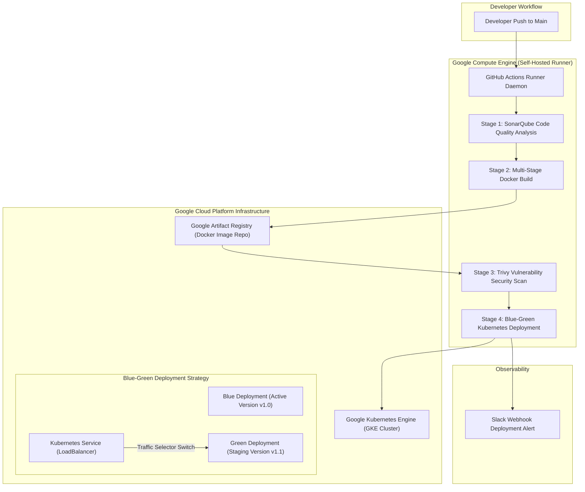

# Deploy Vue.js on Google Kubernetes Engine (GKE): DevSecOps Blue-Green Pipeline

<div align="center">

[](https://github.com/codewithmuh/vuejs-gke-github-actions/releases)
[](https://opensource.org/licenses/MIT)
[](https://github.com/codewithmuh/vuejs-gke-github-actions/stargazers)
[](https://github.com/codewithmuh/vuejs-gke-github-actions/network/members)
[](https://cloud.google.com/kubernetes-engine)
[](https://vuejs.org/)
[](https://github.com/features/actions)
[](https://www.sonarqube.org/)
[](https://trivy.dev/)
[](https://youtu.be/Xn3Xj9Trepc)

**End-to-end DevSecOps CI/CD pipeline deploying a Vue.js single-page application onto Google Kubernetes Engine (GKE) using Blue-Green zero-downtime deployment, self-hosted GCE runners, SonarQube quality gates, and Trivy security scanning.**

[Architecture](#system--pipeline-architecture) • [Features](#key-features) • [Workflow Stages](#cicd-workflow-stages) • [Step-by-Step Implementation](#step-by-step-implementation-guide) • [Kubernetes Manifests](#kubernetes-manifests) • [Resources](#video--community-links)

</div>

---


## Overview

This repository demonstrates an enterprise-grade **DevSecOps** pipeline that automates the delivery of a production-ready Vue.js application onto Google Cloud Platform (GCP). 

By leveraging a self-hosted runner on Google Compute Engine (GCE), container builds are executed close to the cluster. The automated pipeline enforces strict code quality standards via **SonarQube**, scans container images for Common Vulnerabilities and Exposures (CVEs) with **Trivy**, publishes artifacts to **Google Artifact Registry**, and achieves zero-downtime releases on **Google Kubernetes Engine (GKE)** through a declarative Blue-Green traffic routing pattern.

---

## System & Pipeline Architecture



---

## Key Features

- **Vue.js 3 Production Build:** Optimized static frontend assets served via high-performance Nginx web server container.
- **Self-Hosted GCE Runner:** Faster Docker builds, cached layer reuse, and direct IAM role-based authentication without storing permanent cloud keys in GitHub.
- **Multi-Stage DevSecOps Pipeline:**
  1. `1.sonar.yml`: Automated static analysis and code quality gate.
  2. `2.build.yml`: Container image packaging and publishing to Google Artifact Registry.
  3. `3.trivy.yml`: High and critical CVE vulnerability blocking.
  4. `4.deploy.yml`: GKE deployment orchestration and Slack notification.
- **Zero-Downtime Blue-Green Deployment:** Independent Kubernetes deployment targets allow full pre-production verification before instantaneous service selector cutover.

---

## CI/CD Workflow Stages

| Workflow File | Stage | Purpose |
|---|---|---|
| [`.github/workflows/1.sonar.yml`](.github/workflows/1.sonar.yml) | **Quality Gate** | Scans frontend codebase with SonarQube for bugs, code smells, and security hotspots. |
| [`.github/workflows/2.build.yml`](.github/workflows/2.build.yml) | **Container Build** | Packages production Vue.js bundle inside Docker and pushes to Google Artifact Registry. |
| [`.github/workflows/3.trivy.yml`](.github/workflows/3.trivy.yml) | **Vulnerability Scan** | Scans container image layers with Trivy; fails on critical severity vulnerabilities. |
| [`.github/workflows/4.deploy.yml`](.github/workflows/4.deploy.yml) | **GKE Rollout** | Applies Kubernetes manifests to GKE, performs Blue-Green switch, and notifies Slack. |

---

## Step-by-Step Implementation Guide

### 1. Provision GCP Service Account & GCE Instance
Create an unprivileged Google Cloud Service Account with permissions for GKE, Artifact Registry, and Compute Engine. Launch an `e2-medium` or `e2-standard-2` Compute Engine instance on Ubuntu 22.04 LTS.

### 2. Configure GitHub Actions Self-Hosted Runner
On your GCE instance:
```bash
# Download and install GitHub Actions runner
mkdir actions-runner && cd actions-runner
curl -o actions-runner-linux-x64-2.311.0.tar.gz -L https://github.com/actions/runner/releases/download/v2.311.0/actions-runner-linux-x64-2.311.0.tar.gz
tar xzf ./actions-runner-linux-x64-2.311.0.tar.gz

# Configure runner token from GitHub Repo Settings -> Actions -> Runners
./config.sh --url https://github.com/codewithmuh/vuejs-gke-github-actions --token YOUR_RUNNER_TOKEN
sudo ./svc.sh install && sudo ./svc.sh start
```

### 3. Install Tooling & SonarQube Container
```bash
# Install Docker, Trivy, and Kubectl
sudo apt update && sudo apt install -y docker.io kubectl openjdk-17-jdk
curl -sfL https://raw.githubusercontent.com/aquasecurity/trivy/main/contrib/install.sh | sudo sh -s -- -b /usr/local/bin

# Run SonarQube community edition
docker run -d --name sonarqube -p 9000:9000 sonarqube:lts-community
```

### 4. Create Google Artifact Registry
```bash
gcloud artifacts repositories create vuejs-repo \
    --repository-format=docker \
    --location=us-central1 \
    --description="Vue.js Production Docker Registry"
```

### 5. Provision GKE Cluster
```bash
gcloud container clusters create vuejs-cluster \
    --zone=us-central1-a \
    --num-nodes=2 \
    --machine-type=e2-medium
```

---

## Kubernetes Manifests

The cluster is managed via declarative Kubernetes YAML located in [`kubernetes/`](kubernetes/):
- [`deployment-blue-green.yaml`](kubernetes/deployment-blue-green.yaml): Manages Blue and Green deployment replicas with CPU/memory limits, readiness probes, and liveness probes.
- [`service.yaml`](kubernetes/service.yaml): Configures a `LoadBalancer` service targeting the current active deployment version tag.

To switch traffic between versions:
```bash
# Update service target selector from blue to green
kubectl patch service vuejs-service -p '{"spec":{"selector":{"app":"vuejs-green"}}}'
```

---

## Video & Community Links

- 🎥 **Full YouTube Video Tutorial:** [Watch Step-by-Step on YouTube](https://youtu.be/Xn3Xj9Trepc)
- 📝 **LinkedIn Article Breakdown:** [Read on LinkedIn](https://www.linkedin.com/feed/update/urn:li:activity:7157288696419885056/)
- ☕ **Support the Project:** [Buy Me A Coffee](https://www.buymeacoffee.com/codewithmuh)

---

## License

This project is licensed under the [MIT License](LICENSE).
